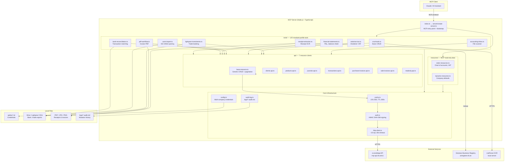

# Architecture Diagram

## Public tool catalog and profiles

`src/tool-catalog.ts` is the exhaustive metadata authority for the full MCP tool surface. Every public registration carries its `ToolMeta` through `registerTool`; `PublicToolRegistrar` validates uniqueness, catalog coverage, reference integrity, and destructive-annotation parity, then filters only the real top-level server. Internal Accounting Inbox capture servers therefore continue to receive the full handler set.

`EARVELDAJA_PROFILE` resolves to `guided`, `guided-sales`, `standard`, `full`, or the legacy-flag-derived `custom`. The public boundary hides excluded tools, while runtime safety binds both the normalized profile and stable catalog fingerprint into execution plans and file references. Guided structured actions are projected before serialization: safe granular calls remap to merged facades; unavailable advanced or future calls become review-only proposals with `advanced_action_unavailable_in_profile` and only `get_setup_instructions` as an executable next action.

## Layer Summary

| Layer | Role |
|---|---|
| **Tools** | Domain logic — invoices, bank, tax, OCR, reporting |
| **API clients** | Resource-specific REST wrappers (CRUD + pagination) |
| **Cache** | In-memory LRU, auto-invalidated on mutations |
| **Auth** | Signs every request with HMAC-SHA-384 |
| **HTTP client** | Rate-limited, timeout-guarded outbound calls |
| **Config** | Multi-company credential loading & switching |
| **Audit log** | Append-only markdown log of all mutations |

## Runtime bootstrap decomposition

Server startup is composed from focused modules rather than one god-file. The
former `src/server-bootstrap.ts` is now a thin re-export barrel (kept only so
existing `./server-bootstrap.js` importers — `index.ts`, the tool-surface
fixture, `tool-profile.ts`, `elicitation.ts`,
and several contract tests — need zero churn). `createMcpServer` and
`buildSetupInstructionsPayload` are re-exported from it.

- **`src/index.ts`** — process entry point: installs the stderr tee and calls
  `createMcpServer()`, with top-level fatal-error handling. The stdio transport
  connect, `setLogger` wiring, and setup-mode startup credential import remain
  owned by the `createMcpServer` orchestrator (behavior-preserving: those steps
  are ordered against the connected server and the `connect:false` test seam).
- **`src/server/create-server.ts`** — the `createMcpServer` composition root:
  config loading + setup-mode detection, connection/audit initialization, the
  `McpServer` construction, the registration-order security boundary (scoping
  Proxy → public catalog/profile boundary → `wrapToolHandler`/`wrapResourceHandler`),
  transport connect, and startup messaging. Owns `buildApiContext`,
  `verifyImportedCredentials`, and credential storage-scope resolution.
- **`src/server/register-system-tools.ts`** — the multi-account / audit-log
  system tools (`get_setup_instructions`, `get_server_status`, `list_connections`,
  `switch_connection`, `get_session_log`, `list_audit_logs`, `clear_session_log`)
  plus `registerCredentialTools` and the cache-control tool, in exact order.
- **`src/server/register-domain-tools.ts`** — the full domain-tool surface,
  resources, and prompts, in the exact registration order (a documented
  security boundary).
- **`src/server/setup-mode.ts`** — setup-mode payloads/errors, the credential-
  blocked API proxy, and `buildSetupInstructionsPayload`, shared by the
  handler-wrapping machinery and the system-tool registrations.
- **`src/server/server-instructions.ts`** — the lean per-session `instructions`
  string (see Workflow prompt pipeline for where detailed guidance lives).
- **`src/runtime/connection-manager.ts`** — active-connection state creation and
  the atomic `switch_connection` core (generation bump + dual cache clear).
- **`src/runtime/invocation-scope.ts`** — the per-invocation `AsyncLocalStorage`
  snapshot store and the connection-scoped API context.
- **`src/runtime/audit-label-resolver.ts`** — resolve-on-first-use audit-log
  company-name labelling.
- **`src/runtime/runtime-context.ts`** — assembles and constructs the runtime
  safety context (plan / file-reference / operation-result / workflow-state
  stores + active-scope resolver).

The decomposition is strictly behavior-preserving: the tool surface, schemas,
instruction text, and responses are byte-for-byte unchanged
(`npm run measure:surface` / `measure:responses` show +0 on every profile).

## Opening balances

e-arveldaja's `/journals` API exposes opening balances as `operation_type=INITIAL`.
`loadJournalsWithOpeningBalance()` returns the original complete API journal set
and identifies its opening journal for status reporting. It never reads a local
opening register or prepends a synthetic journal. All financial reports,
statement comparisons and dividend checks share this loader. Annual cash flows
and closing detection exclude INITIAL journals as starting positions.

The selected journal retains its IDs, effective date, clients and dimensions.
Normal registration/deletion/date/client filters determine which amounts enter
figures. Draft, deleted or empty openings are disclosed; multiple active INITIALs
or malformed D/C amounts stop calculation for review. Nonzero opening postings
without a dimension remain in account totals and the unassigned dimension row,
while dimension reports disclose partial attribution and statement comparisons
skip the tolerance check. No INITIAL is a normal absence, not incomplete API
coverage.

The local parser, store and import tool are removed. Existing user
`opening-balances.json` files are neither read nor deleted. The independent
`statement-balances.json` store remains in the accounting-rules bundle.

## Workflow prompt pipeline

The 16 workflow prompts and their `.claude/commands` slash-command twins are
generated by one pipeline, not hand-written per surface. The stages are:

**registry → workflow source → shared renderer → MCP prompts and slash commands**

1. **Canonical registry — `src/prompt-registry.ts`.** The single source of truth
   for every workflow prompt: its `name`, `slug`, description, feature
   predicate, sales-aware variants, and its argument schema.
   Every prompt argument is a string (parsed through `src/prompt-arguments.ts`),
   not numeric or boolean — a client always passes wire strings, and
   the registry parses them into typed values, rejecting a malformed value with
   a safe bounded MCP error.
2. **Workflow source — `workflows/*.md` via `src/workflow-prompt-source.ts`.**
   The prose body of each prompt lives in a Markdown file under `workflows/`,
   loaded by slug. Prompt **text does not live in `src/prompt-registry.ts` or
   `src/prompts.ts`** — those wire the pipeline; the words come from the
   workflow Markdown, with `E_ARVELDAJA_FEATURE_*` markers delimiting the
   **sales-aware variant** sections that are kept or dropped per deployment.
3. **Shared renderer — `src/prompt-surface.ts`.** One renderer resolves feature
   sections, injects the shared safety wrapper, sandboxes any external text
   inside a fresh per-call `E_ARVELDAJA_RUN_DATA` boundary, and enforces the
   64,000-character surface budget. Both output surfaces render through it, so
   an MCP prompt and its slash command are byte-identical.
4. **Output surfaces.** `src/prompts.ts` registers the rendered prompts as **MCP
   prompts**; `npm run sync:workflow-prompts` writes the same rendered text to
   the `.claude/commands/*.md` slash commands.
   Static commands also state the registry's overall `requiredTools` gate:
   at least one required tool must be advertised before entering the workflow.
   Individual capability sections retain their all-required/unless conditions.

### Load-bearing safety claims the pipeline states

- **A plan handle is not user approval.** The shared wrapper states that a
  server-issued plan handle binds scope only; explicit human approval is
  recorded separately, and no data text can waive an approval gate before a
  mutation. A preview alone is never approval. Existing explicit approval
  remains valid for the same reviewed effects; changed effects need new review.
  Mutating workflows (CAMT, reconciliation, Lightyear, Wise,
  credentials) are one-attempt server plans with pre-mutation drift gates.
- **Opaque file references.** File inputs are exchanged as opaque `file_ref`
  handles bound to the runtime safety context, not raw filesystem paths, so a
  hostile filename never re-enters a later tool call as a live path.
- **Staged receipts.** Legacy document and receipt-batch workflows keep separate
  approvals for **create/upload** of PROJECT (draft) purchase invoices and
  **confirm**/link to bank transactions. In the attended verified-reading flow
  (`EARVELDAJA_DOCUMENT_READING=1`), one explicit owner approval may cover
  create/upload and registration. Creation and confirmation remain separate
  calls; confirmation requires the scoped handle and an unchanged draft
  fingerprint. This exception does not authorize linking bank transactions.
  The receipt-batch create-and-confirm exception must separately show and obtain
  approval for every intended supplier creation, invoice registration, bank
  confirmation/distribution and client reassignment. Its per-file effects are
  bound to the plan and paginated in `reviews`; guided readers request full
  detail and follow every cursor before approval.
  Standard/full pages retain up to 50 entries but shrink when the response
  would exceed the hard detail budget. Signed cursors use the actual next
  offset; a single oversized entry still fails explicitly rather than truncating
  approval evidence.
- **Dated VAT/tax metadata.** VAT facts (threshold, rates, effective/verified
  dates) are rendered from the canonical versioned metadata object in
  `src/estonian-tax-rules.ts`, so every prompt and command shows the same dated
  VAT metadata rather than a hardcoded rate.

### Process safety boundaries

`src/documents/purchase-invoice-lock.ts` shares one credential/connection-scoped
FIFO across automated purchase entry points. Its critical section includes the
final fresh duplicate scan and create/readback. Draft fingerprints are shared by
legacy and verified reading through the neutral
`purchase-invoice-draft-fingerprint.ts` helper (re-exported by
`purchase-draft-verification.ts`); a confirm
handle binds the reviewed draft material rather than only its ID. Reading also
binds the current tax, dimension and history decision notes.

The standard PDF workflow opts into this binding with
`require_confirm_plan:true`. After create/upload it reads the actual draft and
returns a scoped one-use confirmation handle only when verification succeeds.
The existing raw confirm tool accepts that `plan_handle`; guarded calls consume
it before business I/O and the API compares a final uncached draft fingerprint after its
other prerequisites, immediately before registration. A failed post-create
check retains the known invoice ID and prohibits automatic recreation. Legacy
handle-free calls remain available. The final GET and upstream register are
separate requests, so this does not provide an atomic compare-and-swap.
On an unverified connection the existing outer audit resolver may first read
company identity from `/invoice_info`; rejected plans still perform no invoice,
chart or registration request.

`src/banking/transaction-material-snapshot.ts` defines the common bank and linked
invoice material comparison used by intake, reconciliation and the final locked
`TransactionsApi.confirm` guard. Allowed client, status and item transitions name
exact before/after values. Known client writes remain visible in drift errors.
Own-transfer cleanup additionally proves the fresh pair against the actual source
registration journal. Receipt-ledger verification derives expected direction
independently of the posted bank side; unknown direction remains unverified.

`src/sales/create-recovery.ts` keeps uncertain sale-create intents in the runtime
safety context, partitioned by captured connection fingerprint and API base URL.
An uncertain POST preserves its client and blocks overlapping aliases. Owner
release follows a fresh scan, returns no create handle and retains mandatory
fresh scans for later prepares and executions.

These queues and recovery holds coordinate one server runtime. They do not
survive restart, coordinate separate processes or exclude web-UI edits. Fresh
reads reduce drift exposure but cannot eliminate the final server-side
GET-to-write race. Historical aging uses current payment status and exposes that
limitation rather than reconstructing historical settlements.

### Sync and validation

- `npm run sync:workflow-prompts` regenerates the `.claude/commands/*.md`
  mirrors from the workflow sources — edit the `workflows/*.md` source, then
  sync; never edit a mirror by hand.
- `npm run validate:release` checks set-equality across the registry, the
  `workflows/` sources, the `.claude/commands` mirrors, and the README workflow
  table (name set + declared count), so a drift between any surface fails the
  release gate.
